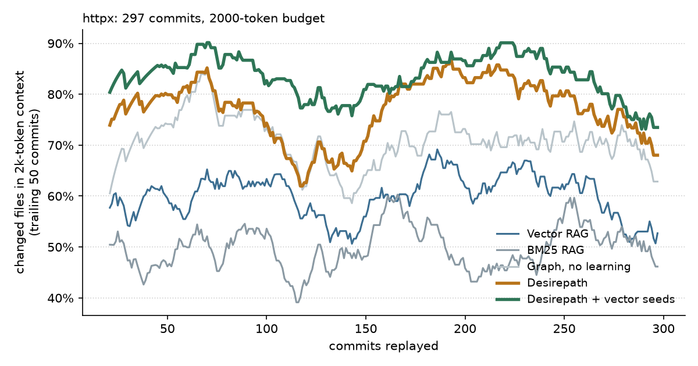
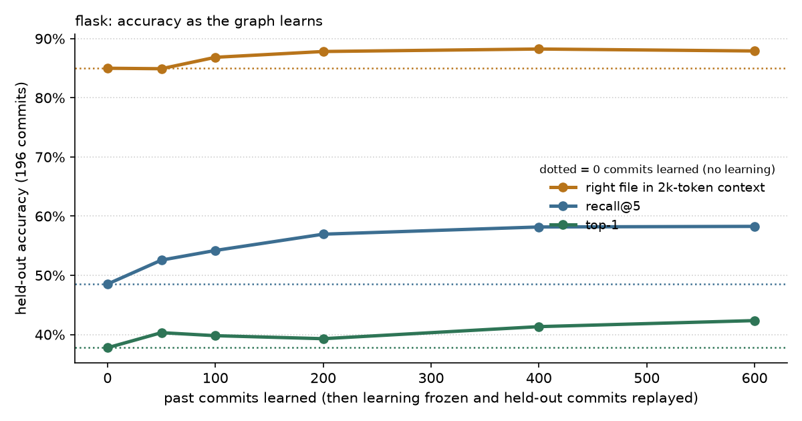
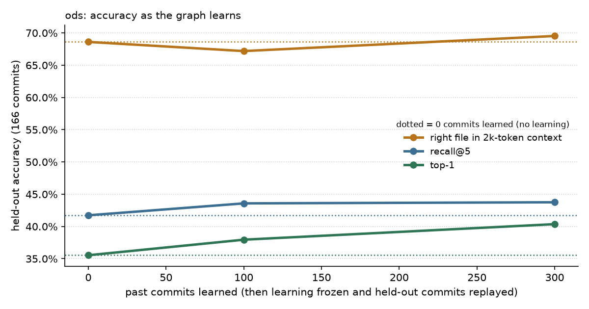
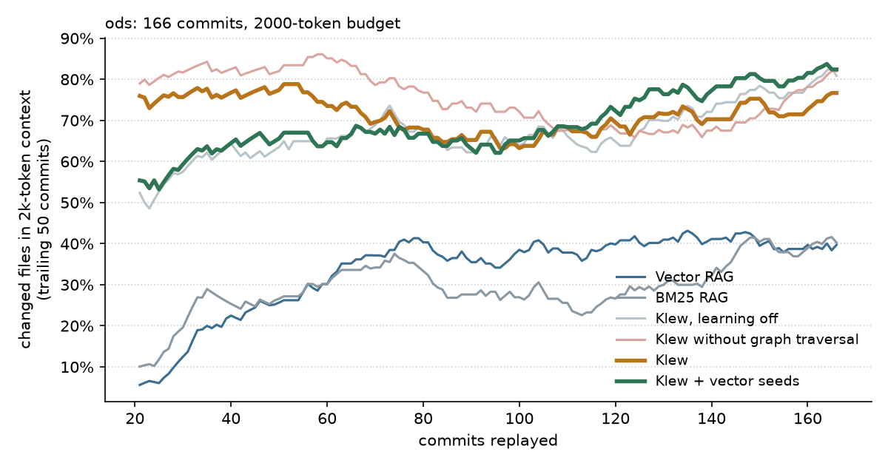

# Klew

**A self-improving context layer for coding agents, built on [HydraDB](https://github.com/hydra-db/hydradb).**

Every session, a coding agent rediscovers your repository by grepping and pasting whole files into its
context. Klew gives it a small map instead: the functions, callers, tests and files that matter for
*this* task, each with the path through the code that connects it to the task. It builds that map by
walking a code graph in HydraDB, not by pulling the most similar-looking chunks. Every merged PR teaches
the graph which paths actually led to the code that changed, so the next map is sharper.

> A *clew* is the ball of thread Ariadne gave Theseus to find his way through the labyrinth; it's where
> the word *clue* comes from. Klew is that thread for your codebase, and every merge makes it stronger.

<!-- RESULTS:START -->
## Results

**In one line:** on every repository, Klew puts the right file in the agent's context 31–47 points more often
than vector RAG at the same budget (statistically significant everywhere), and learning from the repo's history
significantly improves ranking on all three. On ranking alone, Klew with vector seeds beats vector RAG
significantly on httpx and flask; on ODS only its MRR gain is significant.

**How to read these numbers.** *Right file in context*: share of changed files inside the 2,000-token
pack, which is what the agent reads (our headline). *Tokens per correct file*: context tokens spent per
changed file found (lower is cheaper). *Recall@5*: share of changed files in the top five. *Top-1*: how
often the #1 file changed. *MRR*: 1 if the first correct file is #1, ½ at #2, ⅓ at #3, and so on.

Every number below is on **held-out commits**: the first 100 commits of each window were used for
tuning (`scripts/tune.py`), and these are the rest. Every approach gets the same 2,000-token budget.

### httpx: 199 held-out commits (first 100 commits used for tuning)

| Approach | Right file in context | Tokens per correct file | Recall@5 | Top-1 | MRR |
|---|---|---|---|---|---|
| Vector RAG | 58.1% | 3,392 | 63.9% | 47.2% | 62.2% |
| BM25 RAG | 49.1% | 3,685 | 56.2% | 39.2% | 52.3% |
| Klew, learning off | 83.4% | 1,624 | 56.0% | 44.7% | 56.9% |
| Klew without graph traversal | 87.6% | 675 | 65.5% | 49.2% | 62.8% |
| **Klew** | 88.9% | 2,025 | 65.4% | 50.7% | 63.6% |
| **Klew + vector seeds** | 95.3% | 1,986 | 67.3% | 56.8% | 68.8% |

**Key comparisons** (paired 95% bootstrap intervals over these commits; ✓ = the interval excludes 0):

| Comparison | Right file in context | Recall@5 | Top-1 | MRR |
|---|---|---|---|---|
| Klew + vector seeds vs vector RAG | +37.2 [+31.7, +43.1] ✓ | +3.4 [+0.1, +6.9] ✓ | +9.5 [+2.5, +16.6] ✓ | +6.6 [+2.5, +10.9] ✓ |
| Klew vs vector RAG | +30.9 [+24.8, +36.8] ✓ | +1.5 [-3.9, +6.3] | +3.5 [-4.0, +11.1] | +1.4 [-3.7, +6.7] |
| Learning on vs off | +5.6 [+1.7, +9.7] ✓ | +9.4 [+4.8, +13.9] ✓ | +6.0 [+1.5, +10.1] ✓ | +6.7 [+3.4, +10.1] ✓ |
| Graph walk on vs off | +1.4 [-0.7, +3.7] | -0.1 [-0.8, +0.5] | +1.5 [+0.0, +3.5] | +0.8 [-0.2, +2.0] |

- **Learning** (same graph, learning off vs on): +5.6 pts right file in context.
- **Graph traversal** (Klew with vs without the walk): +1.4 pts right file in context, +1.5 pts top-1.

**Accuracy as the graph learns** (learn from N past commits, then freeze; held-out): right file in context 82.0% → 89.1%, recall@5 55.7% → 64.3%, top-1 45.2% → 50.2%, MRR 57.0% → 63.0% from 0 to 600 commits learned.




### flask: 196 held-out commits (never used for tuning; every setting came from httpx)

| Approach | Right file in context | Tokens per correct file | Recall@5 | Top-1 | MRR |
|---|---|---|---|---|---|
| Vector RAG | 45.1% | 4,393 | 48.8% | 36.7% | 49.1% |
| BM25 RAG | 53.2% | 3,311 | 55.0% | 39.3% | 51.5% |
| Klew, learning off | 84.7% | 1,472 | 48.5% | 37.8% | 49.7% |
| Klew without graph traversal | 84.1% | 703 | 60.0% | 44.4% | 56.8% |
| **Klew** | 89.0% | 2,020 | 60.6% | 43.9% | 57.1% |
| **Klew + vector seeds** | 91.6% | 2,087 | 60.1% | 46.4% | 58.4% |

**Key comparisons** (paired 95% bootstrap intervals over these commits; ✓ = the interval excludes 0):

| Comparison | Right file in context | Recall@5 | Top-1 | MRR |
|---|---|---|---|---|
| Klew + vector seeds vs vector RAG | +46.5 [+40.4, +52.2] ✓ | +11.3 [+6.7, +16.2] ✓ | +9.7 [+3.1, +16.3] ✓ | +9.3 [+4.7, +14.1] ✓ |
| Klew vs vector RAG | +43.9 [+37.9, +50.4] ✓ | +11.8 [+5.4, +18.4] ✓ | +7.1 [+0.0, +14.3] | +8.0 [+2.5, +13.3] ✓ |
| Learning on vs off | +4.3 [+1.1, +7.8] ✓ | +12.1 [+6.9, +17.6] ✓ | +6.1 [+0.5, +11.7] ✓ | +7.4 [+3.6, +11.4] ✓ |
| Graph walk on vs off | +4.9 [+1.5, +8.6] ✓ | +0.6 [-0.5, +2.0] | -0.5 [-1.5, +0.0] | +0.3 [-0.5, +0.9] |

- **Learning** (same graph, learning off vs on): +4.3 pts right file in context.
- **Graph traversal** (Klew with vs without the walk): +4.9 pts right file in context, -0.5 pts top-1.

**Accuracy as the graph learns** (learn from N past commits, then freeze; held-out): right file in context 85.0% → 87.9%, recall@5 48.5% → 58.3%, top-1 37.8% → 42.4%, MRR 49.4% → 55.0% from 0 to 600 commits learned.




### ods: 166 held-out commits (never used for tuning; every setting came from httpx)

| Approach | Right file in context | Tokens per correct file | Recall@5 | Top-1 | MRR |
|---|---|---|---|---|---|
| Vector RAG | 35.0% | 5,557 | 45.2% | 39.2% | 51.3% |
| BM25 RAG | 30.7% | 6,282 | 41.8% | 33.7% | 47.0% |
| Klew, learning off | 69.3% | 2,642 | 41.3% | 33.7% | 46.6% |
| Klew without graph traversal | 76.9% | 1,206 | 46.6% | 41.6% | 53.3% |
| **Klew** | 72.4% | 2,702 | 47.3% | 41.6% | 53.5% |
| **Klew + vector seeds** | 71.9% | 2,753 | 48.3% | 45.8% | 57.2% |

**Key comparisons** (paired 95% bootstrap intervals over these commits; ✓ = the interval excludes 0):

| Comparison | Right file in context | Recall@5 | Top-1 | MRR |
|---|---|---|---|---|
| Klew + vector seeds vs vector RAG | +36.9 [+31.8, +42.3] ✓ | +3.1 [-0.5, +6.8] | +6.6 [-0.6, +13.9] | +5.9 [+1.3, +10.2] ✓ |
| Klew vs vector RAG | +37.5 [+30.3, +44.1] ✓ | +2.1 [-5.2, +9.4] | +2.4 [-6.0, +10.8] | +2.2 [-3.8, +8.4] |
| Learning on vs off | +3.1 [-2.1, +8.4] | +6.0 [+2.3, +10.2] ✓ | +7.8 [+4.2, +12.0] ✓ | +6.9 [+4.2, +9.6] ✓ |
| Graph walk on vs off | -4.4 [-9.0, +0.1] | +0.6 [-0.6, +2.1] | +0.0 [+0.0, +0.0] | +0.1 [-0.7, +1.0] |

- **Learning** (same graph, learning off vs on): +3.1 pts right file in context.
- **Graph traversal** (Klew with vs without the walk): -4.4 pts right file in context, +0.0 pts top-1.

**Accuracy as the graph learns** (learn from N past commits, then freeze; held-out): right file in context 68.6% → 69.5%, recall@5 41.7% → 43.8%, top-1 35.5% → 40.4%, MRR 48.3% → 52.0% from 0 to 300 commits learned.





Latency: Klew answers in about 0.2–0.4 s per request versus about 15 ms for a vector lookup.

<!-- RESULTS:END -->

## How it works

```
 repo ──► tree-sitter indexer ──┐                       ┌──────────── HydraDB ────────────┐
 git history ──► co-change ─────┼── UNWIND/MERGE ─────► │ files · symbols · calls · tests │
                                │                       │ imports · inheritance           │
                                │                       │ CO_CHANGED · POINTS_TO (learned)│
                                │                       └───────▲──────────────▲──────────┘
 agent ─MCP─► get_context ─► seed ─► walk (1-hop expansions) ───┘              │
                              │       rank ─► pack (signatures + snippet,      │
                              │                     why-path per file)         │
 merged PR / record_outcome ──┴──► learning rule ─► reinforce / decay ─────────┘
```

1. **Map.** Tree-sitter parses the repo into files and symbols, with calls, imports, inheritance and tests
   between them, resolved statically through each file's imports. Git history adds `CO_CHANGED` edges between
   files that change together. All of it lives in HydraDB.
2. **Walk.** For a task, Klew seeds from names in the task: BM25 over symbol names, docstrings and body
   terms, exact identifiers, plus anything it has learned. It then propagates relevance hop by hop through
   HydraDB (calls, callers, tests, inheritance, imports, co-change), keeping the shortest path to every
   node. Files are ranked, then packed into the token budget as signatures plus the best snippet, each with
   its why-path.
3. **Learn.** When a run or merged PR lands, the files that actually changed reinforce `POINTS_TO` edges from
   the task's words to those files, and files that were served but not touched decay. Files touched together
   reinforce `CO_CHANGED`. Structural edges are facts and never change; experience is learned on top, so
   re-indexing never erases what the graph has learned.

### Why a graph and not a vector store

- **The file you need often doesn't look like the task.** It's the caller, the test, or the config two hops
  away. Similarity can't follow a call edge.
- **It learns without re-embedding.** Outcomes update edge weights in place.
- **Every item says why it's there.** A path through the code is auditable; a cosine score isn't.
- **It spends fewer tokens.** Structure tells us which signature and which body to include.

### How it uses HydraDB

- **Typed graph:** `KlewFile`, `KlewSymbol`, `KlewTerm`, `KlewRun`, `KlewRepo` nodes. `CONTAINS`, `IMPORTS`, `CALLS`,
  `TESTS`, `INHERITS` (structural), `CO_CHANGED`, `POINTS_TO` (learned), `SERVED`, `TOUCHED` (provenance).
- **Traversal where the graph lives:** each hop is one anchored 1-hop expansion per (edge type, direction),
  e.g. `MATCH (a:KlewSymbol)<-[r:CALLS]-(b) WHERE a.id IN $ids RETURN a.id, b.id, r.w`. That's about 34
  queries per context pack, run in parallel within each hop: about 0.2–0.3 s on httpx (warm-started
  graph, laptop, Docker).
- **Learning writes back in place:** batched `UNWIND … MERGE (s)-[r:POINTS_TO {id: row.eid}]->(d) SET r.w = row.w`.
- **Native path search for explanations:** `explain` calls HydraDB's `algo.MSpaths` (GraphBLAS) to find the paths
  through the code from a task's best matches to a file, e.g. `_get_proxy_map` → calls → `get_environment_proxies`
  → contained in → `httpx/_utils.py`.
- **Run history as a graph:** every context request becomes a `KlewRun` with `SERVED` and `TOUCHED` edges, an
  audit trail of what the agent was shown and what it changed.
- All Cypher lives in [`klew/adapters/queries.py`](klew/adapters/queries.py), with the dialect
  rules we verified against HydraDB v0.4.0.

## Install

Klew needs Docker (for a local HydraDB node) and [uv](https://docs.astral.sh/uv/) or pip.

```bash
pip install klew              # or run without installing: uvx klew …
klew hydra up                 # local HydraDB node in Docker
klew index ~/code/your-repo   # build the graph and learn from recent history
klew context --repo your-repo "what you want to change"
```

**Claude Code** (plugin with the MCP server and a skill that tells Claude when to use it):

```text
/plugin install klew --marketplace IronicRayquaza/klew
```

**Claude Desktop**: download `klew.mcpb` from the [latest release](https://github.com/IronicRayquaza/klew/releases)
and double-click it. It asks for your repository folder.

**Cursor, Windsurf and other MCP clients**:

```json
{ "mcpServers": { "klew": { "command": "npx", "args": ["-y", "klew-mcp", "mcp"],
                            "env": { "KLEW_REPO_ROOT": "/absolute/path/to/your/repo" } } } }
```

MCP tools: `get_context(task, budget_tokens, cutoff)`, `record_outcome(run_id, touched_files?)` (defaults to the
working tree's changed files), `explain(task, path)`, and `graph_stats()`. There is deliberately no raw-Cypher
tool.

**Learn from merged PRs:** `klew learn-git <merge-sha>`, or the GitHub Action in [`action/`](action/action.yml).

**From source / dashboard:** `docker compose up -d`, `uv pip install -e ".[dev]"`, `klew serve` (API on :8000)
and `cd web && npm install && npm run dev` (UI on :5173).

## Evaluation

`klew eval <repo> --window 300` replays the last 300 commits that modified 1–8 Python files, in order:

- **task** = the commit message; **truth** = the `.py` files it modified that exist in the snapshot.
- Every arm gets the **same 2,000-token budget**.
- The code is **re-indexed at the parent commit every 50 commits**, so nothing ever sees the future.
- The learning arm learns from each commit **after** answering it, exactly as it would from a merged PR.

Arms: **vector RAG** (bge-small-en-v1.5 over 40-line chunks, local via fastembed), **BM25 RAG** (same
chunks), **graph without learning**, **Klew**, and **Klew + vector seeds**.

Metrics: **right file in context** (share of changed files inside the 2k-token pack, which is what an agent
reads), **recall@5 / recall@10 / hit@1 / MRR** of the file ranking, **tokens per correct file**, and latency.

Limits, stated plainly:
- Commit messages are terser than real agent prompts.
- We score Python files only.
- Static call resolution is best-effort.
- Parameters were tuned on the first 50 commits of the first repository only (`scripts/tune.py`).

## Repository map

| Path | What |
|---|---|
| `klew/schema.py` | labels, edge types, walk steps and priors |
| `klew/adapters/` | HydraDB + in-memory stores, Cypher, tree-sitter reader, git miner |
| `klew/domain/` | pure logic: seeder, walker, packer, learning rule, BM25 |
| `klew/services/` | indexing and the per-repo engine |
| `klew/{mcp_server,cli,api}.py` | interfaces |
| `klew/baselines/`, `klew/eval/` | RAG baselines, replay harness, plots |
| `web/` | landing page, live dashboard, results (Vite + React) |
| `tests/` | domain tests + a store contract test run against both stores |

## License

MIT for this repository. HydraDB is licensed separately under the Elastic License 2.0; we use its
published container image and do not redistribute it.
