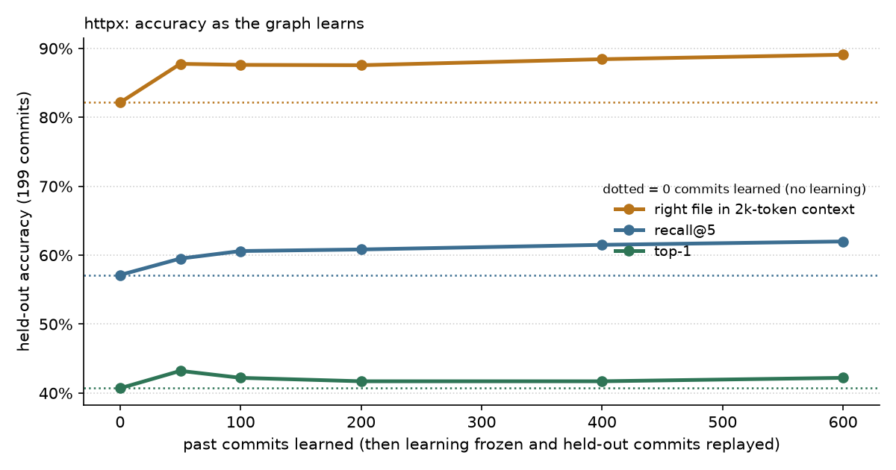

# Klew

**A self-improving context layer for coding agents, built on [HydraDB](https://github.com/hydra-db/hydradb).**

Every session, a coding agent rediscovers your repository by grepping and pasting whole files into its
context. Klew gives it a small map instead: the functions, callers, tests and files that matter for
*this* task, each with the path through the code that connects it to the task. It builds that map by
walking a code graph in HydraDB, not by pulling the most similar-looking chunks. Every merged PR teaches
the graph which paths actually led to the code that changed, so the next map is sharper.

> A *clew* is the ball of thread Ariadne gave Theseus to find his way through the labyrinth; it's where
> the word *clue* comes from. Klew is that thread for your codebase, and every merge makes it stronger.

<!-- RESULTS:START -->
## Results

Every number below is on **held-out commits**: the first 100 commits of each window were used for
tuning (`scripts/tune.py`), and these are the rest. Every approach gets the same 2,000-token budget.

### httpx: 199 held-out commits

| Approach | Right file in context | Tokens per correct file | Recall@5 | Top-1 | MRR |
|---|---|---|---|---|---|
| Vector RAG | 58.1% | 3,392 | 63.9% | 47.2% | 62.2% |
| BM25 RAG | 49.1% | 3,685 | 56.2% | 39.2% | 52.3% |
| Klew, learning off | 83.4% | 1,636 | 58.4% | 40.2% | 55.2% |
| Klew without graph traversal | 87.6% | 675 | 65.5% | 49.2% | 62.8% |
| **Klew** | 89.5% | 2,032 | 60.8% | 40.7% | 56.5% |
| **Klew + vector seeds** | 95.2% | 2,001 | 67.6% | 43.7% | 60.7% |

- **Learning** (same graph, learning off vs on): +6.2 pts right file in context.
- **Graph traversal** (Klew with vs without the walk): +1.9 pts right file in context, -8.6 pts top-1.

**Accuracy as the graph learns** (learn from N past commits, then freeze; held-out): right file in context 82.1% → 89.1%, recall@5 57.1% → 62.0%, MRR 55.5% → 58.1% from 0 to 600 commits learned.




### flask: 196 held-out commits

| Approach | Right file in context | Tokens per correct file | Recall@5 | Top-1 | MRR |
|---|---|---|---|---|---|
| Vector RAG | 45.1% | 4,393 | 48.8% | 36.7% | 49.1% |
| BM25 RAG | 53.2% | 3,311 | 55.0% | 39.3% | 51.5% |
| Klew, learning off | 84.7% | 1,471 | 51.9% | 34.7% | 48.2% |
| Klew without graph traversal | 84.1% | 703 | 60.0% | 44.4% | 56.8% |
| **Klew** | 89.5% | 2,008 | 58.6% | 37.2% | 52.7% |
| **Klew + vector seeds** | 90.9% | 2,129 | 59.6% | 43.4% | 56.6% |

- **Learning** (same graph, learning off vs on): +4.7 pts right file in context.
- **Graph traversal** (Klew with vs without the walk): +5.4 pts right file in context, -7.2 pts top-1.

**Accuracy as the graph learns** (learn from N past commits, then freeze; held-out): right file in context 85.2% → 87.7%, recall@5 52.4% → 55.3%, MRR 48.5% → 51.8% from 0 to 600 commits learned.


Latency: Klew answers in about 0.2–0.4 s per request versus about 15 ms for a vector lookup.

<!-- RESULTS:END -->

## How it works

```
 repo ──► tree-sitter indexer ──┐                       ┌──────────── HydraDB ────────────┐
 git history ──► co-change ─────┼── UNWIND/MERGE ─────► │ files · symbols · calls · tests │
                                │                       │ imports · inheritance           │
                                │                       │ CO_CHANGED · POINTS_TO (learned)│
                                │                       └───────▲──────────────▲──────────┘
 agent ─MCP─► get_context ─► seed ─► walk (1-hop expansions) ───┘              │
                              │       rank ─► pack (signatures + snippet,      │
                              │                     why-path per file)         │
 merged PR / record_outcome ──┴──► learning rule ─► reinforce / decay ─────────┘
```

1. **Map.** Tree-sitter parses the repo into files and symbols, with calls, imports, inheritance and tests
   between them, resolved statically through each file's imports. Git history adds `CO_CHANGED` edges between
   files that change together. All of it lives in HydraDB.
2. **Walk.** For a task, Klew seeds from names in the task: BM25 over symbol names, docstrings and body
   terms, exact identifiers, plus anything it has learned. It then propagates relevance hop by hop through
   HydraDB (calls, callers, tests, inheritance, imports, co-change), keeping the shortest path to every
   node. Files are ranked, then packed into the token budget as signatures plus the best snippet, each with
   its why-path.
3. **Learn.** When a run or merged PR lands, the files that actually changed reinforce `POINTS_TO` edges from
   the task's words to those files, and files that were served but not touched decay. Files touched together
   reinforce `CO_CHANGED`. Structural edges are facts and never change; experience is learned on top, so
   re-indexing never erases what the graph has learned.

### Why a graph and not a vector store

- **The file you need often doesn't look like the task.** It's the caller, the test, or the config two hops
  away. Similarity can't follow a call edge.
- **It learns without re-embedding.** Outcomes update edge weights in place.
- **Every item says why it's there.** A path through the code is auditable; a cosine score isn't.
- **It spends fewer tokens.** Structure tells us which signature and which body to include.

### How it uses HydraDB

- **Typed graph:** `KlewFile`, `KlewSymbol`, `KlewTerm`, `KlewRun`, `KlewRepo` nodes. `CONTAINS`, `IMPORTS`, `CALLS`,
  `TESTS`, `INHERITS` (structural), `CO_CHANGED`, `POINTS_TO` (learned), `SERVED`, `TOUCHED` (provenance).
- **Traversal where the graph lives:** each hop is one anchored 1-hop expansion per (edge type, direction),
  e.g. `MATCH (a:KlewSymbol)<-[r:CALLS]-(b) WHERE a.id IN $ids RETURN a.id, b.id, r.w`. That's about 34
  queries per context pack, run in parallel within each hop: about 0.2–0.3 s on httpx (warm-started
  graph, laptop, Docker).
- **Learning writes back in place:** batched `UNWIND … MERGE (s)-[r:POINTS_TO {id: row.eid}]->(d) SET r.w = row.w`.
- **Run history as a graph:** every context request becomes a `KlewRun` with `SERVED` and `TOUCHED` edges, an
  audit trail of what the agent was shown and what it changed.
- All Cypher lives in [`klew/adapters/queries.py`](klew/adapters/queries.py), with the dialect
  rules we verified against HydraDB v0.4.0.

## Quickstart

```bash
docker compose up -d                       # HydraDB from ghcr.io/hydra-db/hydradb (local, plaintext)
uv venv --python 3.12 .venv && uv pip install -e ".[dev]"
.venv/bin/klew index ~/code/your-repo                 # ~1s for 60 files / 1,200 symbols
.venv/bin/klew context --repo your-repo "what you want to change"
```

**Use it from Claude Code** (from inside the repository):

```bash
claude mcp add klew -- /path/to/klew/.venv/bin/klew mcp
```

MCP tools: `get_context(task, budget_tokens)`, `record_outcome(run_id, touched_files?)` (which defaults to
the working tree's changed files), `explain(task, path)`, and `graph_stats()`. There is deliberately no
raw-Cypher tool.

**Learn from merged PRs:** `klew learn-git <merge-sha>` locally, or the GitHub Action in
[`action/`](action/action.yml) (see `.github/workflows/klew-learn.example.yml`).

**Dashboard:** `klew serve` (API on :8000) and `cd web && npm install && npm run dev` (UI on :5173).
Without the API, the UI falls back to a recorded snapshot.

## Evaluation

`klew eval <repo> --window 300` replays the last 300 commits that modified 1–8 Python files, in order:

- **task** = the commit message; **truth** = the `.py` files it modified that exist in the snapshot.
- Every arm gets the **same 2,000-token budget**.
- The code is **re-indexed at the parent commit every 50 commits**, so nothing ever sees the future.
- The learning arm learns from each commit **after** answering it, exactly as it would from a merged PR.

Arms: **vector RAG** (bge-small-en-v1.5 over 40-line chunks, local via fastembed), **BM25 RAG** (same
chunks), **graph without learning**, **Klew**, and **Klew + vector seeds**.

Metrics: **right file in context** (share of changed files inside the 2k-token pack, which is what an agent
reads), **recall@5 / recall@10 / hit@1 / MRR** of the file ranking, **tokens per correct file**, and latency.

Limits, stated plainly:
- Commit messages are terser than real agent prompts.
- We score Python files only.
- Static call resolution is best-effort.
- Parameters were tuned on the first 50 commits of the first repository only (`scripts/tune.py`).

## Repository map

| Path | What |
|---|---|
| `klew/schema.py` | labels, edge types, walk steps and priors |
| `klew/adapters/` | HydraDB + in-memory stores, Cypher, tree-sitter reader, git miner |
| `klew/domain/` | pure logic: seeder, walker, packer, learning rule, BM25 |
| `klew/services/` | indexing and the per-repo engine |
| `klew/{mcp_server,cli,api}.py` | interfaces |
| `klew/baselines/`, `klew/eval/` | RAG baselines, replay harness, plots |
| `web/` | landing page, live dashboard, results (Vite + React) |
| `tests/` | domain tests + a store contract test run against both stores |

## License

MIT for this repository. HydraDB is licensed separately under the Elastic License 2.0; we use its
published container image and do not redistribute it.
